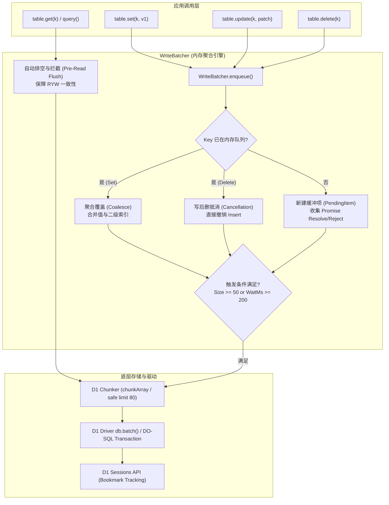

# Auto Batch 与写入自动聚合技术及可靠性白皮书

> 本文档详细介绍了 `cloudflare-worker-kvdb` 中的 **Auto Batch（微批处理）** 与 **内存级写操作自动聚合（In-Memory Write Coalescing）** 机制，深入解析其在 Serverless 边缘环境下的设计初衷、底层实现、在 SQLite 与 PostgreSQL 中的性能收益、以及全链路高可靠性保障。

---

## 目录

- [1. 背景痛点与设计初衷](#1-背景痛点与设计初衷)
- [2. 核心技术架构与聚合机制](#2-核心技术架构与聚合机制)
  - [2.1 整体架构视图](#21-整体架构视图)
  - [2.2 内存级净增量聚合 (In-Memory Coalescing)](#22-内存级净增量聚合-in-memory-coalescing)
  - [2.3 参数安全分块 (Parameter-Safe Chunker)](#23-参数安全分块-parameter-safe-chunker)
- [3. 数据库适配与价值收益：SQLite vs PostgreSQL](#3-数据库适配与价值收益sqlite-vs-postgresql)
  - [3.1 在 SQLite / Cloudflare D1 中的表现（救命稻草）](#31-在-sqlite--cloudflare-d1-中的表现救命稻草)
  - [3.2 在 PostgreSQL / Hyperdrive 中的表现（极度有效）](#32-在-postgresql--hyperdrive-中的表现极度有效)
  - [3.3 数据库收益对比矩阵](#33-数据库收益对比矩阵)
- [4. 全链路可靠性与一致性保障体系](#4-全链路可靠性与一致性保障体系)
  - [4.1 读己之写一致性 (Read-Your-Own-Writes / RYW)](#41-读己之写一致性-read-your-own-writes--ryw)
  - [4.2 D1 会话级因果连续性 (Sessions & Bookmark)](#42-d1-会话级因果连续性-sessions--bookmark)
  - [4.3 边缘生命周期防冻结保护 (`ctx.waitUntil`)](#43-边缘生命周期防冻结保护-ctxwaituntil)
  - [4.4 并发流水线与状态防重 (Flushing Pipeline & Deduplication)](#44-并发流水线与状态防重-flushing-pipeline--deduplication)
  - [4.5 异常精准回传与零吞没 (Zero Error Swallowing)](#45-异常精准回传与零吞没-zero-error-swallowing)
- [5. 配置指南与最佳实践](#5-配置指南与最佳实践)
  - [5.1 基础配置代码示例](#51-基础配置代码示例)
  - [5.2 最佳实践场景矩阵](#52-最佳实践场景矩阵)
  - [5.3 权衡与适用边界](#53-权衡与适用边界)

---

## 1. 背景痛点与设计初衷

在基于 Cloudflare Serverless 生态（Cloudflare Workers、D1、Durable Objects）构建高性能分布式存储层时，传统的单条记录写入模式面临极其严苛的物理限制：

```
                    ┌─────────────────────────┐
                    │ Cloudflare Edge Worker  │
                    │      (Each Isolate)     │
                    └───────────┬─────────────┘
                                │
        Discrete Writes         │ High-Frequency Network Roundtrips
     (table.set() x 100)        │ Edge-to-Leader Write Serialization
                                ▼
                    ┌─────────────────────────┐
                    │    Cloudflare D1 Leader │
                    │   (Single-Leader SQLite)│
                    │   - Write lock queue    │
                    │   - Max 100 params limit│
                    └─────────────────────────┘
```

1. **D1 单主排队写瓶颈（Single-Leader SQLite Serialization）**：
   Cloudflare D1 虽然在全球拥有海量只读副本（Read Replicas），但所有的写入（`INSERT` / `UPDATE` / `DELETE`）都必须路由到主节点（Primary Leader）进行单线程排队写入。如果每个 Worker 请求都单独调用 `await table.set()` 或 `await table.update()`，短时间内密集的写操作会迅速导致写锁排队争用（`database is locked` / Write Contention），大幅拉长请求延迟（RTT）。
2. **D1 严格的参数限制（Parameter-Safe Limits）**：
   Cloudflare D1 驱动规定单条 SQL 语句绑定的参数数量**严禁超过 100 个**（`D1_MAX_PARAMS_LIMIT = 100`）。若将多个实体拼装在单条语句而不做安全分块，会直接抛出 `D1_ERROR: too many SQL variables` 崩溃。
3. **Serverless Worker 的生命周期截断（Isolate Suspension）**：
   Cloudflare Workers 是无状态微任务运行时。一旦处理逻辑向客户端返回了 HTTP `Response`，若后台异步任务未向引擎声明存活，宿主 Isolate 可能在几毫秒内被系统挂起（Freeze）或直接销毁，导致内存中未持久化的写操作无声丢失。
4. **同一运行时内的读己之写一致性（Read-Your-Own-Writes / RYW）**：
   如果启用了后台批处理，写操作被暂存在内存缓冲区等待攒批；若紧接着同一个请求或并发请求读取相同 Key，如何保证读到最新数据而不是底层数据库的旧值？

为了彻底解决上述痛点，`cloudflare-worker-kvdb` 设计并实现了 **微批处理写缓冲区（`WriteBatcher<V>`）** 与 **内存级写操作自动聚合（In-Memory Coalescing）**。

---

## 2. 核心技术架构与聚合机制

### 2.1 整体架构视图

系统在 `Table` 抽象层与底层物理存储驱动（D1 / DO-SQL / Hyperdrive）之间建立了一层无锁内存缓冲区：



核心文件构成：
- `src/core/batcher.ts`：实现 `WriteBatcher<V>`，负责基于时间窗口与容量阈值的微批排队、Promise 收集以及内存级状态合并。
- `src/core/chunker.ts`：实现 `chunkArray` 与 `chunkByParamCount`，确保批处理下发到底层 SQL 时严格遵循 D1 100 变量硬限制。
- `src/core/table.ts`：接入 `WriteBatcher`，在读写路径上实现透明预取、内存直通与 RYW 读前强制排空。

### 2.2 内存级净增量聚合 (In-Memory Coalescing)

自动聚合的核心在于：**在毫秒级微批窗口内，通过数学上的“净增量（Net-Delta）”计算，消除冗余的磁盘与网络 I/O。**

#### 1. 覆盖写聚合（Set-Set Coalescing）
在指标统计、状态机更新或同一热点记录的并发写入场景中，客户端在 200ms 窗口内连续调用：
```ts
table.set("user:100", { score: 10 });
table.set("user:100", { score: 20 });
table.set("user:100", { score: 30 });
```
- **传统无聚合模式**：向数据库发送 3 次网络请求，执行 3 次 SQL `INSERT ... ON CONFLICT DO UPDATE`，消耗 3 次写锁排队。
- **AutoBatch 聚合模式**：
  - `WriteBatcher` 以 Key 为键维护 `Map<string, PendingBatchItem<V>>`。
  - 第二次、第三次调用命中同一条目，直接更新内存中的目标值（覆盖为 `{ score: 30 }`），并保留合并二级索引（`keys`）。
  - 将所有调用者的 `resolve` / `reject` 回调推入该条目的数组。
  - **结果**：底层仅收到 **1 条 SQL**，最终写入最新状态 `{ score: 30 }`，此前发起调用的 3 个 Promise 在物理提交完成后同时被解决。

#### 2. 读-改-写内存直通（In-Memory Update Acceleration）
当使用 `table.update(key, updaterFn)` 时：
```ts
// 第一次更新
table.update("counter", (prev) => ({ count: (prev?.count ?? 0) + 1 }));
// 极短时间内的后续更新
table.update("counter", (prev) => ({ count: (prev?.count ?? 0) + 5 }));
```
- **工作机制**：
  1. `table.update` 优先查询 `writeBatcher.getPending(key)`。
  2. 若该 Key 已在待写入队列中，**直接在内存中取出暂存值，同步传入 updaterFn / patch 进行计算**。
  3. **跳过数据库查询**（0 次读网络往返，0 次反序列化开销）。
  4. 新计算得出的值重新放回内存聚合槽中，等待窗口期结束一次性写入底层。

#### 3. 写后立即删除的完全抵消（Set-Delete Cancellation）
在短生命周期任务、临时凭证或撤回操作中：
```ts
table.set("temp_token", { token: "abc" });
table.delete("temp_token"); // 同一微批窗口内执行
```
- **工作机制**：
  - `enqueueDelete` 检测到当前窗口内已经存在该 Key 的 `set` 任务。
  - 先将之前的 `set` 条目在内存中标记消除，移除待写入的插入数据。
  - 之前的 `set()` Promise 立即就绪，避免挂起。
  - 批次提交时，**完全不向数据库发送 `INSERT` 语句**，只向底层发送删除或者内存直接抵消。
  - 杜绝了“先无谓写入增加 WAL 负担，再执行 DELETE”的资源浪费。

### 2.3 参数安全分块 (Parameter-Safe Chunker)

对于包含数十个字段的复杂实体，单次批量插入 50 条记录很容易导致绑定变量超过 100 个限制。
SDK 内置切片器（`src/core/chunker.ts`）：
- `chunkArray(items, 50)`：对纯操作语句进行安全切块。
- `chunkByParamCount(items, paramsPerItem, 80)`：严格按照每项占用的 SQL 参数数量计算安全批次大小（默认安全上限设为 80，远低于 D1 的 100 硬限制），从根源杜绝 `D1LimitError`。

---

## 3. 数据库适配与价值收益：SQLite vs PostgreSQL

这项技术不仅在 Cloudflare D1 / SQLite 中是“救命稻草”，在面对传统关系型数据库（如 PostgreSQL / Supabase）时同样极具价值，但两者的侧重点有所不同：

### 3.1 在 SQLite / Cloudflare D1 中的表现（救命稻草）

在 SQLite / D1 体系中，这项技术是**架构能否抗住高并发的分水岭**。

#### 1. 突破 SQLite 的“单写者锁（Single-Writer Lock）”硬伤
- **底层原理**：SQLite 在设计上是**文件级/单锁写模型**。不论你在外部开多少个并发请求，同一时刻**有且仅能有一个写事务**持有排他锁写入数据库。
- **离散写的后果**：如果并发 100 个请求各自 `INSERT`/`UPDATE`，这 100 个写操作必须串行排队。如果在 Cloudflare D1 分布式架构下，每一次写还要跨越边缘到主节点的网络往返（比如 50ms），100 次写排队耗时可能高达数秒，极易引发 `SQLITE_BUSY` 或写超时报错。
- **Auto Batch 的效果**：将这 100 次写在内存中聚合成 1 个 `db.batch()` 事务，排他锁只获取一次，在几毫秒内提交完毕，写吞吐量提升数十倍。

#### 2. 避免频繁的磁盘 `fsync` / WAL 写入
- **底层原理**：没有显式事务的单条 SQL 会自动开启隐式事务，每次提交都可能触发一次磁盘同步刷盘（`fsync`）。
- **性能飞跃**：
  - 单条独立写 SQLite：一般只能达到 **50 ~ 200 writes/sec**。
  - 批处理事务写 SQLite：轻松跑满 **50,000+ writes/sec**（纯内存写 WAL，一次性刷盘）。

### 3.2 在 PostgreSQL / Hyperdrive 中的表现（极度有效）

PostgreSQL 虽然具备先进的行级锁（Row-Level Lock）和高并发多进程架构，但在高并发场景下，Auto Batch 与聚合同样具有极高的价值：

#### 1. 消除 PostgreSQL 致命的“MVCC 死元组（Dead Tuples）”与表膨胀
- **底层原理**：PostgreSQL 的并发控制基于 MVCC。**在 Postgres 里，`UPDATE` 操作本质上并不是原地修改数据，而是将旧行标记为删除，并新插入一行（Dead Tuple）**。
- **痛点**：如果系统内有一个热点计数器或高频更新的状态位，在 1 秒内被更新了 100 次：
  - **传统模式**：Postgres 会在表中生成 **99 条死元组（Dead Tuples）**！这会导致表体积和索引急剧膨胀（Table Bloat），给后台的 `VACUUM` 进程带来沉重的 I/O 清理压力。
  - **自动聚合模式**：在客户端内存中完成合并累加，在微批窗口结束时只向 Postgres 发送**最终的 1 次 UPDATE**。数据库层只产生 1 个新版本，彻底消除了 99% 的死元组！

#### 2. 消除热点行锁等待（Hot-Row Lock Contention）与死锁风险
- 当多个并发请求同时试图修改同一行记录时，后继事务必须排队等待排他行锁。当并发量达到上千时，行级锁竞争会导致 CPU 飙升、连接池耗尽，甚至在复杂业务中引发死锁（Deadlock）。
- 聚合技术在客户端将同一个 Key 的修改“压平”为一次提交，把行锁持有时间缩短到了极致。

#### 3. 保护脆弱的数据库连接池（Serverless 连接危机）
- 在 Serverless 环境访问 PostgreSQL 时，物理连接数是极其有限的。微批处理能让每个 Worker 减少 90% 的交互频次，避免瞬间打满连接池。

### 3.3 数据库收益对比矩阵

| 评估维度 | 在 SQLite / D1 中的影响 | 在 PostgreSQL 中的影响 |
| :--- | :--- | :--- |
| **主要解决的痛点** | 解决 **单写者写锁排队**、网络 RTT、磁盘 `fsync` 瓶颈 | 解决 **MVCC 表膨胀 (Dead Tuples)**、热点行锁冲突、连接池枯竭 |
| **单条离散写瓶颈** | 极低（约 100 QPS 就会锁住或排队） | 中高（但受行锁、网络和事务日志限制） |
| **聚合写收益** | **50x ~ 100x+** 吞吐量提升 | **5x ~ 20x+** 吞吐量提升，大幅降低 CPU 与死元组 |
| **内存直通更新价值** | 避免向 D1 Leader 节点发起的网络 RPC | 避免在 Postgres 中触发昂贵的全索引更新与锁等待 |

---

## 4. 全链路可靠性与一致性保障体系

批处理最常被担忧的问题是“异步数据丢失”、“脏读”以及“故障传播”。`cloudflare-worker-kvdb` 通过 5 层防线建立了工业级的可靠性保障。

### 4.1 读己之写一致性 (Read-Your-Own-Writes / RYW)

在同一个 Worker 实例内，绝不允许出现“刚刚 set 的值，紧接着下一行 get 却拿不到最新数据”的现象。

```ts
// src/core/table.ts 核心读路径保护
async get(key: string | number): Promise<V | null> {
  validateKey(key);
  // 若当前 key 处于内存缓冲队列中，或当前有正在进行的批量刷新操作
  if (this.writeBatcher && (this.writeBatcher.hasPending(key) || this.writeBatcher.isFlushingNow)) {
    // 强制执行排空并等待，确保数据库具有最新物理状态
    await this.writeBatcher.flush();
  }
  // 从底层读取最新数据...
}
```
所有读取方法（`get`、`getRecord`、`getBy`、`getMany`）以及结构变更方法（`addKey`、`addIndex`）在读取或修改物理数据前，都会拦截并强制等待 `flush()` 完成，确保在当前 Isolate 视角下永远满足顺序一致性。

### 4.2 D1 会话级因果连续性 (Sessions & Bookmark)

Cloudflare D1 读副本存在毫秒级的异步同步延迟。为了防止后续读取路由到落后的只读副本：
1. 每次 `WriteBatcher` 刷新执行 `db.batch()` 提交时，D1 会在元数据中返回当前操作的事务日志标记（`meta.bookmark`）。
2. SDK 驱动立即提取该标记并更新会话游标：
   ```ts
   if (lastResult?.meta?.bookmark) {
     this.driver.setBookmark(lastResult.meta.bookmark);
   }
   ```
3. 后续当前 Worker 发起的所有读请求都会携带此 Bookmark，强制路由到已同步该版本号的 D1 副本，实现全局因果连续性。

### 4.3 边缘生命周期防冻结保护 (`ctx.waitUntil`)

在 Cloudflare Workers 中，若写操作由定时器异步触发，而主请求已经发送了 HTTP 响应，V8 隔离区可能会被系统冻结导致写入中断。

```ts
// WriteBatcher 注册生命周期守护
if (this.ctx && typeof this.ctx.waitUntil === "function") {
  this.ctx.waitUntil(this.waitForPendingDrain());
}
```
- **工作机制**：
  - 启动定时器的同时，向 Cloudflare 运行时注册 `ctx.waitUntil(this.waitForPendingDrain())`。
  - 明确通知 Cloudflare 底层：**在内存缓冲区清空且正在执行的底层提交完成之前，严禁冻结或销毁此 Isolate。**
  - 这保证了即使请求已经响应给终端用户，后台批写依然能 100% 安全落地。

### 4.4 并发流水线与状态防重 (Flushing Pipeline & Deduplication)

为了防止高并发写入导致多次 `flush()` 相互踩踏或状态混乱：
- **`isFlushing` 与 `activeFlushPromise` 屏障机制**：
  - 当一个批次正在向底层提交（网络 I/O 耗时）时，标记 `isFlushing = true`，并将当前在途的 Promise 赋给 `activeFlushPromise`。
  - 此时若有新的写操作进入，它们安全地积攒在 `pendingOps` 新一轮快照中，绝对不会污染正在发送给数据库的数组。
  - 此时若有并发的 `flush()` 或读操作调用，直接 `await this.activeFlushPromise`，等待上一批完成，而无需重复发起重复网络请求。
  - 提交完成后，若发现排队期间有新数据积攒，立即安排下一轮自动触发。
- **`inFlightUpdates` 防击穿**：
  - 对初次 `update()` 引入去重机制，防止多个并发更新在首次加载初始值时对数据库产生缓存击穿式的并发读。

### 4.5 异常精准回传与零吞没 (Zero Error Swallowing)

假定在数据库提交时发生不可抗力（如网络故障、唯一索引约束冲突、超时）：
```ts
} catch (err) {
  for (const op of snapshot) {
    for (const reject of op.rejects) {
      reject(err); // 精确传播给该批次内的每一个调用者
    }
  }
} finally {
  this.isFlushing = false;
  this.activeFlushPromise = undefined;
}
```
- **零异常吞没**：整批中每个参与的 Promise 都会捕获到确切的底层错误对象。
- **状态不卡死**：`finally` 保证清除锁定状态，不影响后续正常的重试与操作。

---

## 5. 配置指南与最佳实践

### 5.1 基础配置代码示例

AutoBatch 可以在全局数据库层开启，也可以在具体的表（Table）级别独立定制：

```typescript
import { CloudflareKVDB } from "cloudflare-worker-kvdb";

export default {
  async fetch(request: Request, env: Env, ctx: ExecutionContext) {
    const db = new CloudflareKVDB({
      d1: env.DB,
      // 全局启用 AutoBatch
      autoBatch: {
        maxBatchSize: 50,  // 积攒达到 50 条立即刷新（默认 50）
        maxWaitMs: 100,     // 防抖等待时间最大 100ms（默认 200ms）
        ctx,               // 必须传入 Worker ExecutionContext 守护后台生命周期
      },
    });

    const userTable = db.table<User>("users", {
      schema: {
        primaryKey: { name: "id", type: "string" },
        columns: { role: { type: "string", index: true } }
      }
    });

    // 并发执行的 set / update 会自动在内存聚合，并在 100ms 内合并为单次原子 db.batch() 写入 D1
    await Promise.all([
      userTable.set("u1", { id: "u1", role: "admin" }),
      userTable.set("u1", { id: "u1", role: "admin", updated: true }), // 自动覆盖合并
      userTable.update("counter", (c) => ({ count: (c?.count ?? 0) + 1 })), // 内存直通
      userTable.delete("temp_cache"),
    ]);

    return new Response("OK");
  }
};
```

### 5.2 最佳实践场景矩阵

| 业务场景 | 推荐模式 | 说明 |
| :--- | :--- | :--- |
| **已知的大规模批量导入**（如同步 500 条数据） | `table.setMany([...])` | 数据已知，无需等待防抖，直接进行参数分块并批量执行。 |
| **高并发请求穿插写**（如点赞、计数器、用户日志） | `autoBatch: { maxBatchSize: 50, maxWaitMs: 100 }` | 极大减少 D1 写锁冲突，将上百次网络请求骤降为 1~2 次。 |
| **金融级强一致事务**（扣款、库存绝对锁定） | 单独调用 `table.set()` 并在返回前 `await table.flush()` 或关闭该表的 `autoBatch` | 消除任何异步停留窗口，确保即时物理刷盘。 |
| **长尾防丢保证** | **务必传入 `ctx` 参数** | 将执行上下文传给 `autoBatch.ctx` 或 `table` 选项，防止 Worker 退出造成截断。 |

### 5.3 权衡与适用边界

作为严谨的工程方案，Auto Batch 具备明确的适用边界：

1. **绝对强即时持久化场景（Zero-Wait Durability）**：
   - 如果业务要求写入后必须立即确认落盘（如转账确认），不建议等待异步防抖。此时可在操作后立即显式调用 `await table.flush()`，或直接在没有开启 `autoBatch` 的表上操作。
2. **极致低延迟要求（p99 Latency）**：
   - 批处理是通过适度牺牲单个写操作的“即时性”（等待 `maxWaitMs`，通常为 10~200ms）来换取“极高的整体吞吐量和并发安全性”。若系统需要单写 5ms 内完成，应调低 `maxWaitMs`（例如 `10ms`）或直接写入。
3. **未刷盘节点崩溃风险（RPO）**：
   - 在数据暂存内存的窗口期内，若进程遭遇致命异常被底层强杀，内存缓冲有丢失风险。SDK 通过 `ctx.waitUntil` 保证正常生命周期下的绝对安全，但极端硬件断电场景依然受限于内存储存的本质。
